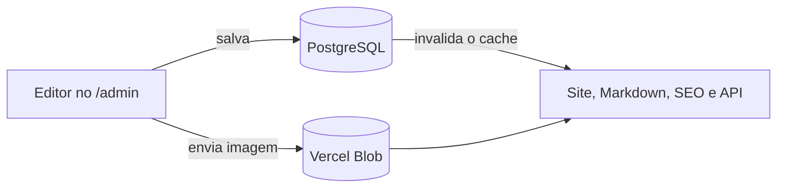

<p align="center"></p>

<h1 align="center">CADe UFPel</h1>

<p align="center">
  Site do Centro Acadêmico de Design da UFPel, com conteúdo editável por um painel.<br>
  <a href="https://cadeufpel.com">cadeufpel.com</a> · painel em <code>/admin</code>
</p>

---

## Sumário

1. [Visão geral](#visão-geral)
2. [Começando](#começando)
3. [Para quem edita o conteúdo](#para-quem-edita-o-conteúdo)
4. [Para quem desenvolve](#para-quem-desenvolve)
5. [Publicação e migrações](#publicação-e-migrações)
6. [Segurança e acesso](#segurança-e-acesso)
7. [Verificação](#verificação)
8. [Contribuição](#contribuição)

## Visão geral

| | |
|---|---|
| **Site** | Next.js 16.4.0 (App Router), React e TypeScript, com o CSS global original, migrado do Figma |
| **Painel** | [Payload CMS](https://payloadcms.com) 3.90.2 em `/admin`, login individual por e-mail e senha |
| **Banco** | PostgreSQL (texto editável) |
| **Imagens** | Vercel Blob |
| **E-mail** | Resend (formulários e recuperação de senha) |
| **Hospedagem** | Vercel. Cada merge na `main` publica em produção |

O painel e o site rodam no **mesmo projeto Next.js**.



- Ao salvar no painel, o cache é invalidado e o site, o Markdown (`/index.md`, `/sobre.md`…), os metadados e `/api/oportunidades` mudam na hora.
- **Salvar não gera commit no GitHub.** O código (campos, permissões, componentes) continua versionado aqui.
- `cms/seed/**/*.json` é só a **carga inicial**: `npm run cms:seed` importa esse conteúdo para um banco vazio e não toca no que já existe. Depois disso, edite pelo painel, nunca pelos JSON.

## Começando

Requer Node.js **24.x** e um PostgreSQL acessível.

```sh
npm ci
cp .env.example .env.local     # ou defina as variáveis no ambiente
npm run cms:migrate            # cria as tabelas
npm run cms:seed               # importa o conteúdo inicial e cria o 1º administrador
npm run dev
```

Painel: `http://localhost:3000/admin`.

### Comandos

| Comando | O que faz |
|---|---|
| `npm run dev` | Servidor de desenvolvimento |
| `npm run build` / `npm start` | Build e servidor de produção |
| `npm test` | Testes (Vitest) |
| `npm run typecheck` | Checagem de tipos |
| `npm run cms:migrate` | Aplica migrações pendentes |
| `npm run cms:migrate:create` | Gera migração após mudar campos |
| `npm run cms:seed` | Carga inicial (só em banco vazio) |
| `npm run cms:types` | Regenera `payload-types.ts` |
| `npm run cms:importmap` | Regenera o importMap do painel |

O `postinstall` aplica uma correção específica ao Next 16.4.0 para preservar o `Vary: Accept` do proxy ([PR #92058](https://github.com/vercel/next.js/pull/92058)); ele falha se a versão ou o template do Next mudar. Reavalie com uma requisição HTTP real antes de atualizar o Next.

### Variáveis de ambiente

| Variável | Obrigatória | Uso |
|---|---|---|
| `DATABASE_URL` | sim | Conexão PostgreSQL |
| `PAYLOAD_SECRET` | sim | Segredo longo e aleatório (sessões/JWT). Sem valor padrão |
| `PAYLOAD_PUBLIC_SERVER_URL` | produção | Origem canônica (`https://cadeufpel.com`); defina **só em Production**. No preview da Vercel (`VERCEL_ENV=preview`) é ignorada e vale a `VERCEL_URL`, para que links de e-mail e URLs do admin apontem para o próprio preview. Em dev, `http://localhost:3000` |
| `BLOB_READ_WRITE_TOKEN` | produção | Armazenamento de imagens. Sem ele, o upload falha em produção |
| `RESEND_API_KEY` | produção | Formulários (`/api/enviar`) e e-mails do CMS. Em produção o boot falha sem ela |
| `CMS_EMAIL_REMETENTE` | produção | Remetente **verificado no Resend** dos e-mails do CMS (ex.: `cms@cadeufpel.com`). Em produção o boot falha sem ele |
| `CMS_ADMIN_EMAIL`, `CMS_ADMIN_PASSWORD` | só no seed | Primeiro administrador. Sem padrões; o seed nunca altera uma conta existente |
| `CMS_UPLOAD_LOCAL` | dev | `true` grava imagens em `cms/media-local/` (ignorado pelo Git e proibido em produção) |
| `RESEND_TO`, `RESEND_FROM` | não | Destinatário (padrão `cadesignufpel@gmail.com`) e remetente (padrão `CADe UFPel <naoresponda@cadeufpel.com>`) dos formulários |
| `CMS_VERIFICACAO_EMAIL` | não | `true` exige verificação de e-mail em novas contas (por padrão as contas são criadas por um administrador) |

## Para quem edita o conteúdo

Tudo se edita em `/admin`. As telas são agrupadas em *Atualize sempre*, *Página inicial*, *Outras páginas* e *Configurações avançadas*.

### Oportunidades

Edite **Oportunidades** no painel. Cada item tem:

| Campo | Efeito |
|---|---|
| `publicado` | Desmarque para esconder sem apagar |
| `titulo`, `tag`, `cor`, `resumo`, `texto`, `cta`, `link` | Conteúdo do cartão e dos detalhes |
| `expira` | Data inclusiva, dia de São Paulo; vazio não expira |

`/api/oportunidades` lista até 12 itens publicados e vigentes.

### Gestão: home e `/sobre` leem da mesma lista

A lista **Membros da gestão** (*Gestão e quem somos*) alimenta o carrossel da home, a página `/sobre` e o `/sobre.md`.

- Cada membro tem nome, foto, enquadramento, **Cargo** (opcional) e **Faz parte da coordenação**.
- Marcados aparecem em "Coordenação" (foto grande e cargo); os demais, em "Membros". Enquanto ninguém estiver marcado, todos aparecem em "Membros".
- A ordem é a da lista: arraste para reordenar.
- O texto depois da contagem ("pessoas"), o botão para `/sobre` e os títulos "Coordenação" e "Membros" também são campos dessa tela. Vazio mantém o padrão.
- Em `/sobre`, o bloco aparece depois da seção cujo **Estilo** é `Gestão` (*Sobre* → Seções).

### Estilos de seção

Nas páginas *Sobre*, *Contato* e *Privacidade* (Seções → Estilo):

| Estilo | Resultado |
|---|---|
| `Texto` | Padrão |
| `Canais` | Lista de contatos com filete rosa |
| `Lista` | Itens `- **Título** — descrição` viram título à esquerda e descrição à direita, sem o travessão |
| `Gestão` | Acrescenta a coordenação e os membros depois do texto da seção |

Em bancos que já existiam, o seed não roda de novo: depois de `npm run cms:migrate`, escolha esses estilos no painel.

### Imagens

PNG, JPEG ou WebP, até **4 MiB**, nome em `kebab-case`. São convertidas para WebP e limitadas a 2048 × 2048; SVG é recusado.

A Vercel rejeita corpos de requisição acima de ~4,5 MB (HTTP 413) antes de o Payload rodar. Entre 4 MiB e ~4,5 MB o painel mostra a nossa mensagem; acima disso o erro é genérico. Fotos de celular costumam passar disso: reduza ou exporte em WebP antes de enviar.

## Para quem desenvolve

### Estrutura

| Caminho | Responsabilidade |
|---|---|
| `app/(site)/` | Site público: home, `/sobre`, `/contato`, `/privacidade`, `/galeria`, Markdown, `llms.txt`, APIs públicas |
| `app/(payload)/` | Painel `/admin` e REST do CMS em `/api/cms` (layout raiz isolado) |
| `app/global-not-found.tsx` | 404 do site (HTML; Markdown para clientes programáticos via `proxy.ts`) |
| `components/` | Markup React portado do site original |
| `app/styles/` | CSS global na ordem original da cascata |
| `payload.config.ts`, `cms/` | Configuração, 21 globais estruturadas, usuários, mídia, acesso, seed, migrações |
| `cms/seed/` | Carga inicial (somente leitura pelo seed) |
| `cms/migrations/` | Migrações do PostgreSQL (versionadas) |
| `lib/conteudo.ts` | Lê as globais no banco, valida e projeta para o contrato público; cache com tag `conteudo-cade` |
| `lib/md-paginas.ts`, `lib/seo.ts` | Markdown para agentes e SEO gerados do mesmo conteúdo |
| `proxy.ts`, `next.config.ts`, `vercel.json` | Negociação de `Accept`, redirects, headers e preset Next.js |
| `public/assets/` | Fontes, marca e imagens estáticas |
| `test/` | Contratos públicos, autorização, mídia, seed e projeção (Vitest) |

### Formulários (`/api/enviar`)

| Proteção | Comportamento |
|---|---|
| Origem | Só aceita POST com `Origin` ou `Referer` do mesmo host; senão 403. Barreira leve: um script pode forjar o cabeçalho |
| Tamanho | Corpo acima de 20.000 caracteres dá 413, checado pelo `Content-Length` e também pelo corpo já lido (cobre POST sem `Content-Length`) |
| Campos | Limites: nome 120, e-mail 254, semestre 40, área 200, tipo 30, assunto 150, mensagem 5.000, contato 200. Excesso, tipo errado ou e-mail inválido dão 400. Os `maxLength` de `components/Formularios.tsx` espelham esses valores |
| Taxa | 5 envios por IP a cada 10 minutos; o 6º dá 429 com `Retry-After`. Contador em memória por instância serverless: freia abuso simples, não um ataque distribuído. Para isso, configure uma regra de rate limit no Firewall da Vercel para `/api/enviar` |
| Honeypot | Campo `empresa` preenchido finge sucesso e não envia |
| Saída | Todos os campos passam por `escapeHtml`; quebras de linha são removidas do assunto |

Testes em `test/api-enviar.test.ts`.

### Chaves públicas do Google

A home e `/galeria` carregam Agenda (Calendar) e galeria (Drive) direto do navegador com uma chave `AIzaSy…`, visível a qualquer visitante. No Google Cloud Console, mantenha-a restrita a referenciadores `cadeufpel.com/*` e `www.cadeufpel.com/*` e apenas às APIs Calendar e Drive. Se vazar sem restrição, gere outra.

## Publicação e migrações

### Primeira publicação (uma vez)

1. **Banco:** crie um PostgreSQL (por exemplo Neon, pela Vercel Marketplace) e defina `DATABASE_URL`.
2. **Blob:** crie um Vercel Blob **público** (um store privado faz todo upload falhar com "Cannot use public access on a private store", e o acesso não pode ser mudado depois) e conecte-o com **token estático**, que define `BLOB_READ_WRITE_TOKEN`. Pela CLI: `vercel blob create-store cade-blob-public --access public --region gru1`; se a conexão cair no modo OIDC, `vercel storage update <store_id> --auth token --add-rw-token`. A conexão não pode coexistir com um `BLOB_READ_WRITE_TOKEN` antigo no mesmo ambiente: remova o antigo antes.
3. **Variáveis na Vercel:**
   - Em Production e Preview: `DATABASE_URL`, `PAYLOAD_SECRET` (≥ 32 caracteres, valor diferente em cada ambiente), `BLOB_READ_WRITE_TOKEN`, `RESEND_API_KEY` e `CMS_EMAIL_REMETENTE` (domínio verificado no Resend).
   - **Só em Production:** `PAYLOAD_PUBLIC_SERVER_URL=https://cadeufpel.com`.
   - Opcional: `RESEND_TO`/`RESEND_FROM`.
   - O build falha em produção sem `RESEND_API_KEY` e `CMS_EMAIL_REMETENTE`, e sem `PAYLOAD_PUBLIC_SERVER_URL` fora do preview.
   - Remova `GITHUB_CLIENT_ID`, `GITHUB_CLIENT_SECRET` e `SHEET_OPORTUNIDADES_CSV`, se existirem (o site antigo usava a planilha; este não).
4. **Esquema e conteúdo iniciais**, contra o banco de produção. Use **Node 24** (`node -v`). Os comandos `cms:*` leem um `.env.local` (ignorado pelo Git; apague-o depois). **Não defina `NODE_ENV=production`** no shell: em produção o boot exige também `RESEND_API_KEY` e `CMS_EMAIL_REMETENTE`. Não use `vercel env pull`: variáveis Secret/Sensitive não são baixadas.

   | Comando | Precisa de |
   |---|---|
   | `npm run cms:migrate` | `DATABASE_URL` (o **de produção**) e `PAYLOAD_SECRET` (qualquer valor com ≥ 32 caracteres). Não precisa do token do Blob |
   | `npm run cms:seed` (só em banco vazio) | O mesmo, mais `PAYLOAD_PUBLIC_SERVER_URL` e `BLOB_READ_WRITE_TOKEN` (**do Blob de produção**). Sem o token o seed se recusa a rodar: gravaria imagens no banco sem arquivo, e uma segunda execução não corrige |

   Depois da migração, crie o primeiro administrador. O comando pergunta e-mail e senha, para a senha não ficar no histórico. Use um e-mail que você abre (ele recebe a recuperação de senha) e uma senha longa e única.

   ```sh
   # bash
   read -rp 'E-mail: ' CMS_ADMIN_EMAIL; read -rsp 'Senha: ' CMS_ADMIN_PASSWORD; echo; export CMS_ADMIN_EMAIL CMS_ADMIN_PASSWORD; npm run cms:seed; unset CMS_ADMIN_EMAIL CMS_ADMIN_PASSWORD
   ```

   ```powershell
   # PowerShell
   $env:CMS_ADMIN_EMAIL = Read-Host 'E-mail'; $env:CMS_ADMIN_PASSWORD = Read-Host 'Senha' -MaskInput; npm run cms:seed; Remove-Item Env:CMS_ADMIN_EMAIL, Env:CMS_ADMIN_PASSWORD
   ```

   Confirme que o `DATABASE_URL` do `.env.local` é o de produção antes de rodar. Depois do seed, abra Mídias no painel e confirme que a URL de uma imagem aponta para `*.public.blob.vercel-storage.com`. Troque a senha no primeiro acesso e crie os editores em Acesso → Usuários.
5. **Validação no preview** do que não dá para testar localmente (precisa do Blob e do Resend reais):
   - Upload de um PNG grande: deve virar WebP ≤ 2048 px, com URL direta `*.public.blob.vercel-storage.com`.
   - Nome de arquivo fora do padrão é recusado com mensagem clara. Teste **dois** tamanhos: ~4,2 MB (mensagem de limite) e 6 MB ou mais (a Vercel rejeita com 413; anote o que o painel mostra).
   - "Esqueceu a senha?": o e-mail chega, o link redefine a senha e o login seguinte funciona.
   - Login de um editor de teste: edita conteúdo, mas não cria usuário nem altera papel.

O `vercel.json` seleciona o preset `nextjs`. Hosts e aliases antigos continuam redirecionando para o domínio canônico sem `www`.

### Mudanças de campos e migrações

> **Regra de ouro:** preview e produção **dividem o mesmo banco**. Código novo contra um esquema antigo derruba todas as rotas (`column ... does not exist`). Migre **antes** de mesclar.

1. Gere a migração junto com a mudança do campo (`npm run cms:migrate:create`), versione-a e rode `npm run cms:types`.
2. **Antes do merge**, confira com `npx payload migrate:status` e aplique com `npm run cms:migrate` contra o banco de produção (mesmo `.env.local` do passo 4). Migrações já aplicadas são puladas. Migração que só adiciona colunas nuláveis ou valores de enum é compatível com o código antigo, então rodá-la antes não quebra o site no ar.
3. Em coluna `NOT NULL` nova de uma global que já tem linha, adicione a coluna nulável, preencha e só então exija `NOT NULL` (veja `cms/migrations/*_disponibilidade.ts`).
4. O `down` gerado pelo Payload faz cast direto de enum: ao reverter valores novos, converta antes (veja `*_gestao_cargo_lista.ts`).

| Migração | O que faz |
|---|---|
| `inicial` | Esquema inicial |
| `disponibilidade` | Três colunas na global de formulários, com textos preenchidos |
| `foto_perfil` | Foto no perfil de usuário |
| `gestao_cargo_lista` | `cargo` e `coordenacao` dos membros; estilos `Gestão` e `Lista` das seções |
| `rotulos_quem_somos` | Rótulos editáveis da gestão |

## Segurança e acesso

- Login **individual** por e-mail e senha: sessões revogáveis, cookie `HttpOnly`, bloqueio de 15 min após 5 falhas, JWT fora do corpo das respostas. Sem GitHub, Google ou tokens compartilhados.
- **Não existe cadastro público.** Só administradores criam usuários (Acesso → Usuários).

| Papel | Pode |
|---|---|
| **Administrador** | Editar conteúdo; gerenciar usuários, papéis e ativação |
| **Editor** | Editar conteúdo, mídia e o próprio perfil. Não vê outros usuários, não promove papel, não cria contas |

- Desativar um usuário derruba as sessões e bloqueia novo login. Conteúdo e imagens públicas são de leitura aberta; qualquer escrita exige conta ativa.
- **Recuperação de senha:** "Esqueceu a senha?" envia e-mail pelo Resend (link válido por 1 h, um pedido por minuto). Por isso `RESEND_API_KEY` e `CMS_EMAIL_REMETENTE` são obrigatórios em produção. Em desenvolvimento sem chave, o envio falha de forma explícita.
- Todo upload passa pelo servidor (validação e conversão); as imagens são servidas por URL direta do Blob.

## Verificação

```sh
npm test && npm run typecheck && npm run build && npm start
```

A suíte cobre negociação, oportunidades, redirects, SEO e Markdown, formulários, autorização (anônimo, editor, administrador, conta desativada), regras de mídia, idempotência do seed e projeção do conteúdo. Complete com requisições reais ao build:

```sh
curl -i -H "Accept: text/markdown" http://localhost:3000/sobre
curl -I -H "Accept: text/html" http://localhost:3000/sobre
curl -i http://localhost:3000/nao-existe
```

HTML deve conter `Vary: Accept`, link alternativo Markdown e ajuda para agentes; caminho inexistente retorna 404. Confira 1180, 900, 720, 400 e 390 px sem overflow horizontal.

## Contribuição

Leia `AGENTS.md`. A copy oficial vem do Figma; use os tokens, Material Symbols por codepoint e identificadores estáveis. Não adicione analytics, pixels, beacons ou scripts externos de telemetria (o Payload está com `telemetry: false`).

`codegraph.config.json` inclui HTML, CSS, JavaScript, TypeScript/TSX e Markdown, excluindo assets, `.next/`, dependências, mídia local, migrações, segredos e scratch. Confirme `codegraph version` e `codegraph --help` antes de consultar; use somente leitura e verifique `analysis`/`freshness`. A configuração MCP é do ambiente do agente.
